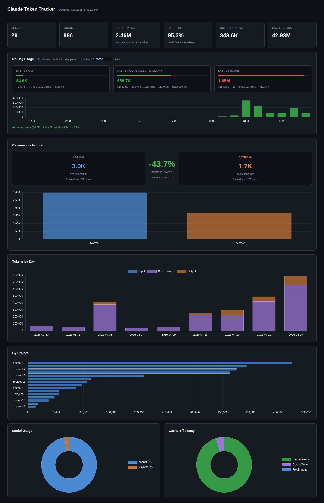

# Claude Token Tracker

Dashboard for tracking Claude Code token usage from local session data. Useful on a Claude Pro or Max subscription when you want visibility into how much you're consuming and when.



## What it tracks

- **Total usage** — sessions, turns, cost tokens, cache hit rate, subagent transcripts included
- **API-equivalent cost** — Claude Code's own `cost-state` tally per session (USD at API list prices, not your subscription bill), including side calls the transcripts don't log
- **Rolling windows** — 1h / 5h / 24h token usage with color-coded gauges (5h = Anthropic's reset window)
- **Burn rate** — tokens/hour with projection of when the 5h window fills
- **Caveman vs normal** — avg tokens/turn comparison for the [caveman plugin](https://github.com/JuliusBrussee/caveman). Auto-detects plugin install, breaks down by mode (lite/full/ultra/wenyan), and shows daily adoption trend. Onboarding callout if plugin not installed.
- **By day / by project** — usage breakdown over time; projects attributed **per turn** from the files each tool call touches, so one session working across several repos splits correctly
- **Environmental impact** — estimated electricity, on-site water and CO₂e per project, always shown as a low–central–high range with the sources behind every coefficient (see [Environmental estimates](#environmental-estimates))
- **Tags** — group usage by `client`, `kind`, or any tag you define (see [Project attribution](#project-attribution))
- **Model breakdown** — Sonnet vs Opus vs Haiku split
- **Cache efficiency** — reads vs writes vs fresh input

## How it works

Reads `~/.claude/projects/*/` — the JSONL session files Claude Code writes locally, plus subagent transcripts under `<session>/subagents/`. No API calls, no external services. All data stays local.

> **Privacy:** the container mounts `~/.claude` (your full prompt history and transcripts). `docker-compose.yml` publishes the port on `127.0.0.1` only. Don't change that to `0.0.0.0` — anyone on your LAN or tailnet could then browse the dashboard.

## Quick start (Docker)

```bash
docker compose up -d
# open http://localhost:9420
```

Mounts `~/.claude` read-only. Stats refresh automatically every 5 minutes. Force a refresh anytime:

```bash
curl -X POST http://localhost:9420/api/refresh
```

### Configuration

Set via environment variables in `docker-compose.yml`:

| Variable | Default | Description |
|----------|---------|-------------|
| `PORT` | `9420` | HTTP port |
| `CLAUDE_DIR` | `/data/.claude` | Path to Claude data dir inside container |
| `REFRESH_INTERVAL` | `300` | Seconds between auto-refresh |
| `STATS_PATH` | `/data/stats.json` | Where parsed stats are written |

## Manual usage (no Docker)

```bash
# Parse session data → stats.json
python3 parser/parse.py

# Anonymize project names (for screenshots/sharing)
python3 parser/parse.py --anonymize

# Serve dashboard from project root
python3 -m http.server 9420
# open http://localhost:9420/frontend/
```

## Project attribution

By default every turn counts toward the directory Claude Code was launched in. To split usage when you work across several repos from one directory (a "hub"), create `~/.config/claude-token-tracker/tags.toml` — start from [`tags.example.toml`](tags.example.toml):

```toml
[[hub]]                 # ~/work/api/... → project "api"
path = "~/work"
tags = { client = "my-business" }

[[project]]             # explicit; longest prefix wins
path = "~/work/company-site"
name = "site"
tags = { kind = "web" }
```

Each turn is matched on the paths its tool calls touch (Edit/Write/Read, `cd` in Bash) and smoothed per user prompt; prompts with no file activity inherit the previous project. Subagents inherit their parent's project at spawn time.

**Manual override:** copy [`extras/commands/tag.md`](extras/commands/tag.md) to `~/.claude/commands/` and run `/tag <project>` in a session — everything after it counts toward that project (and picks up its tags if it's in `tags.toml`).

The Docker setup mounts `~/.config/claude-token-tracker` read-only and passes `HOME_DIR` so `~` resolves to your host home.

## Environmental estimates

No AI provider publishes energy per token, so the dashboard estimates it from token counts using coefficients in [`parser/energy.toml`](parser/energy.toml): Wh per million tokens for fresh input, cache writes, cache reads and output, scaled per model family, then converted to on-site cooling water and CO₂e at a configurable grid intensity. Every coefficient cites its source; the range spans Epoch AI's short-context figures (low) to Simon Couch's deliberately pessimistic Claude rates (high). Treat the numbers as order-of-magnitude, and override them with `ENERGY_CONFIG=/path/to/your.toml` if you have better data.

## Soft limit

Dashboard has a configurable soft limit input (default: auto-calibrated from historical peak 5h window + 10% headroom). Gauges go green → orange → red as you approach it.

Anthropic doesn't expose actual quota. If you hit a real rate limit, note the 5h token count shown at that moment and set it as your limit.

## Requirements

Python 3.11+ (stdlib `tomllib`), no dependencies. Docker for containerized deployment. Chart.js loaded from CDN.
